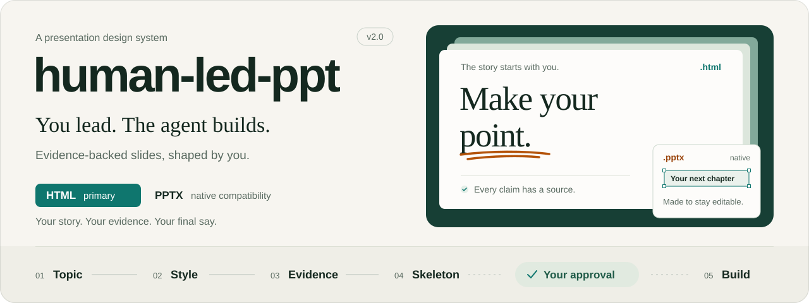
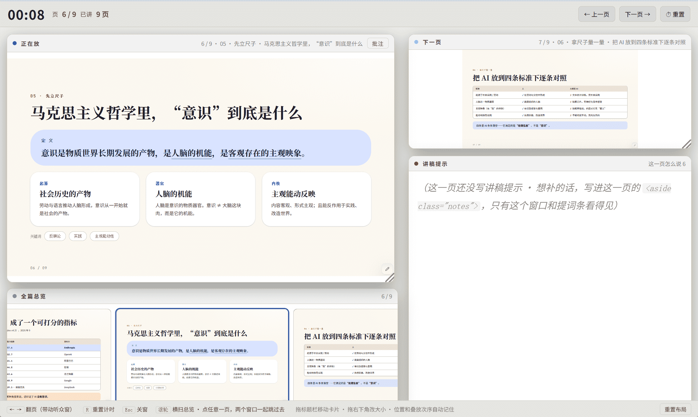
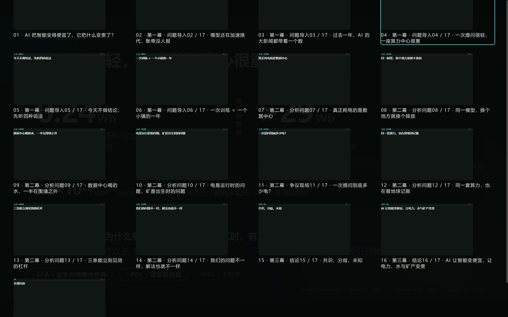
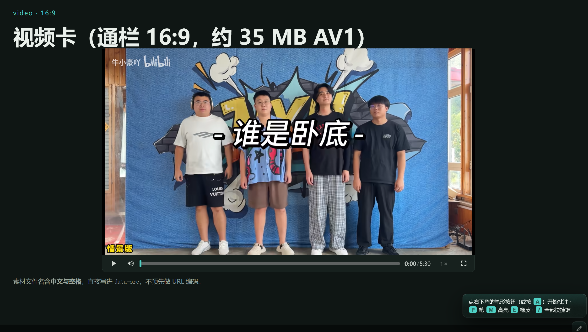

<h1 align="center"></h1>

**English** · [中文](README_zh-cn.md) · [日本語](README_ja.md)

**A human-led, agent-assisted presentation skill.** You choose the topic, style and wording; the agent handles evidence, structure and building. HTML is the primary format, with native PPTX support. Building starts after you approve the skeleton.

   

> [!note]
> This project has moved to Codeberg for development. GitHub is kept only as a synchronized mirror.

## Install and use

Copy `human-led-ppt/` into your skills directory, reload the session and invoke `/human-led-ppt`, or describe the task:

- “Make an HTML deck about X for Y, lasting 10 minutes.”
- “Make an editable PPTX.”
- “Deliver both HTML and PPTX.”

## Choose a format

| Format               | Best for                                                    | Delivery                                              |
| -------------------- | ----------------------------------------------------------- | ----------------------------------------------------- |
| HTML (primary)       | Offline presenting, interaction, annotation and two windows | `.html`; include sibling media and local linked files |
| PPTX (compatibility) | File submission and continued editing in PowerPoint         | `.pptx`, `-PPTX-src.json`, `-PPTX-qa.md`              |
| Both                 | Presenting and editable handover                            | Shared sources; separate skeletons, builds and checks |

You choose in step 1; the agent does not choose for you. HTML embeds images and needs no external libraries. PPTX relies on installed fonts and the PowerPoint environment.

## Workflow

| Step                  | Work and output                                                             |
| --------------------- | --------------------------------------------------------------------------- |
| 1 Topic               | Confirm format, audience, duration and narrative                            |
| 2 Style               | Choose from 22 presets / templates; record the style decision               |
| 3 Sources (as needed) | Record evidence, figures, citations and gaps                                |
| 4 Skeleton            | Per-slide specifications and prompts; **approval required before building** |
| 5 Build               | Assemble HTML or compile native PPTX from the skeleton                      |
| 6 Verify              | Confirm who checks; audit structure, figures and rendered output            |
| 7–8 Optional layers   | HTML annotation / blackboard and presenter windows; prompts require review  |

## Charts and presenting

- **21 SVG templates**: 11 charts and 10 diagrams; [open the gallery](assets/visual-templates.html).
- **Four appearances**: rounded cards, outline, blueprint and editorial; search, category filters, light/dark previews and code copying.
- **HTML navigation**: keyboard / click / touch paging, `G` overview, `F` fullscreen, `Q` shortcuts and page memory.
- **Optional features**: media transport, evidence badges enabled per deck, annotation and presenter mode.

## PPTX boundaries

- Run `assets/pptx/detect-engine.cjs` first. Claude Code / Codex / ZCode / dsh check for a host PPTX plugin and fall back to officecli if absent; other hosts use officecli.
- officecli requires `1.0.159`; non-fade transitions and in-slide animation require `1.0.160`. Install only the binary; never run `officecli install`.
- Native objects compile from `PPTX-src.json`. Rebuilding overwrites manual PowerPoint edits; confirm the editing approach after delivery.
- Arbitrary existing PPTX redesign and corporate masters are unsupported; complex charts may degrade. Without PowerPoint, screenshots do not prove pixel or playback parity.

## Documentation

[Skill entry](SKILL.md) · [English constraints](references/en/02-style.md) · [Changelog](CHANGELOG.md)

Full steps live in `references/en/`, with matching [中文](references/zh) and [日本語](references/ja) versions.

## Preview

## Credits and license

Layout and presenter interactions reference [HTML PPT Studio](https://github.com/lewislulu/html-ppt-skill); the PPTX method references [ppt-master](https://github.com/hugohe3/ppt-master) (MIT). These inform design and methods; no code was copied. Style R references [guizang-ppt-skill](https://github.com/op7418/guizang-ppt-skill); S–V reference [frontend-slides](https://github.com/zarazhangrui/frontend-slides) (MIT, © Zara Zhang). PPTX tooling uses [OfficeCLI](https://github.com/iOfficeAI/OfficeCLI) (Apache-2.0).

[MIT](LICENSE), © Makitoid Wang.
