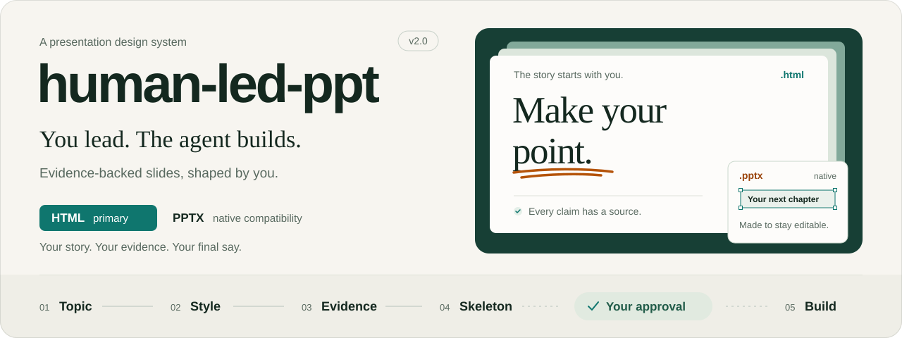
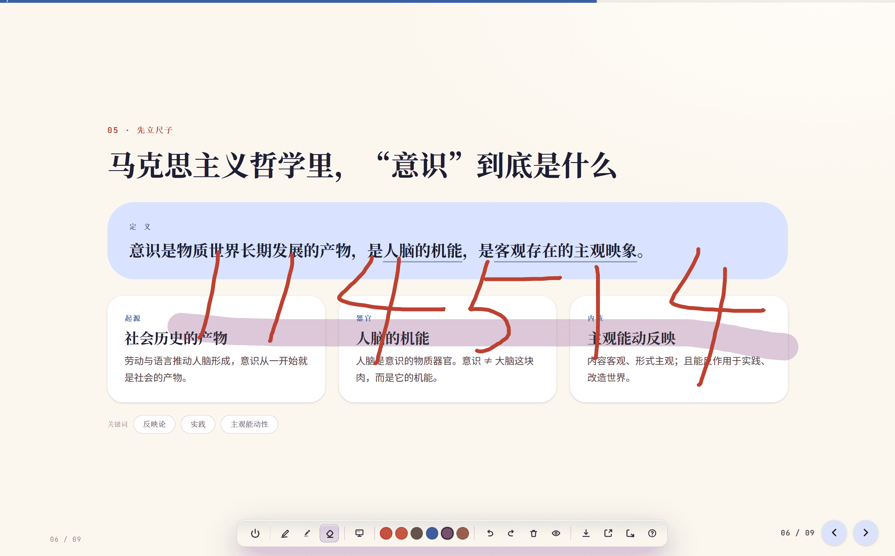
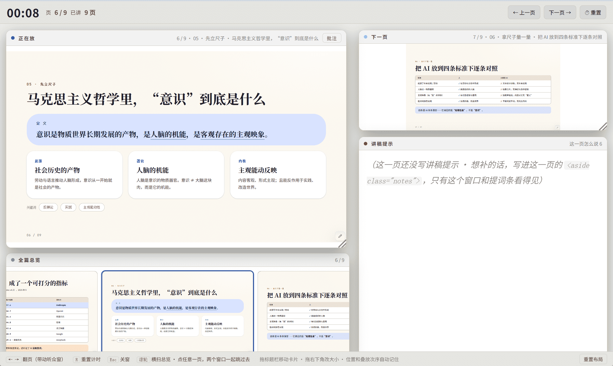
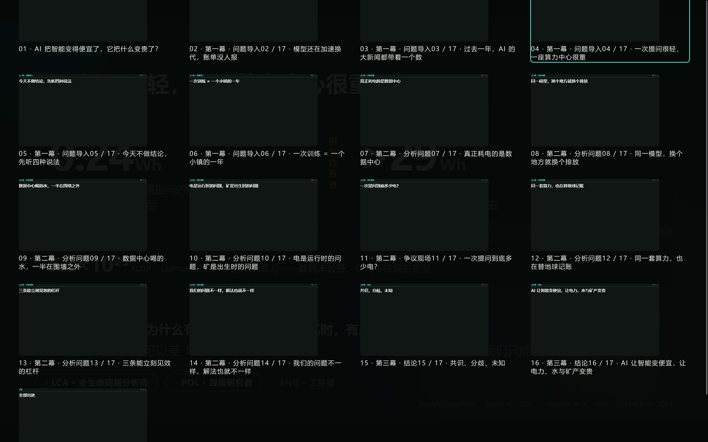
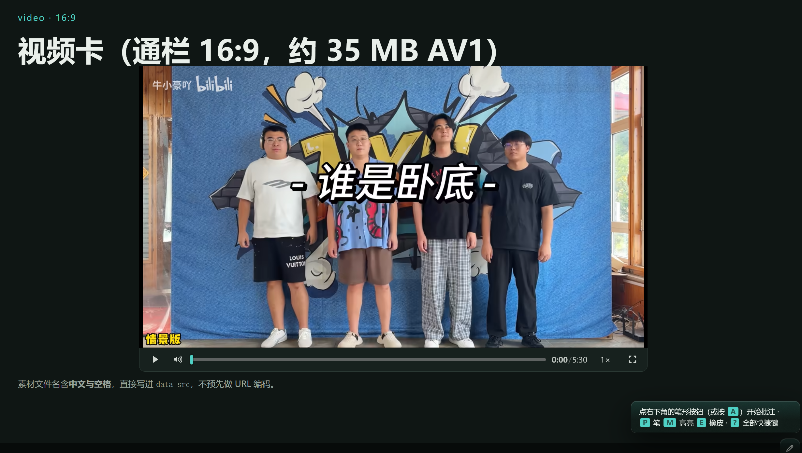

<h1 align="center"></h1>

[English](README.md) · [中文](README_zh-cn.md) · **日本語**

**人主導・エージェント支援のプレゼン作成 skill。** テーマ・スタイル・文言は人が決め、根拠・構成・構築はエージェントが担当します。HTML を主軸に、ネイティブ PPTX にも対応。骨子の承認後に構築を始めます。

   

> [!note]
> 開発は Codeberg に移行しました。GitHub は同期用のミラーとしてのみ維持しています。

## インストールと使い方

`human-led-ppt/` をスキルディレクトリへコピーし、セッションを再読み込みして `/human-led-ppt` を実行するか、依頼を入力します。

- 「Y 向けに、X について 10 分の HTML プレゼンを作って」
- 「編集可能な PPTX を作って」
- 「HTML と PPTX の両方がほしい」

## 納品形式を選ぶ

| 形式         | 用途                                     | 成果物                                      |
| ------------ | ---------------------------------------- | ------------------------------------------- |
| HTML（主軸） | オフライン発表、操作、注記、2 ウィンドウ | `.html`。音声・動画・ローカルリンク先は同梱 |
| PPTX（互換） | ファイル提出、PowerPoint での継続編集    | `.pptx`、`-PPTX-src.json`、`-PPTX-qa.md`    |
| 両方         | 発表と編集用ファイルの引き渡し           | 資料を共有し、骨子・構築・検証は別々        |

形式はステップ 1 でユーザーが選びます。HTML は画像を内蔵し外部ライブラリ不要。PPTX はインストール済み書体と PowerPoint の環境に依存します。

## ワークフロー

| ステップ         | 内容と成果物                                               |
| ---------------- | ---------------------------------------------------------- |
| 1 テーマ         | 形式、聴衆、時間、構成を確認                               |
| 2 スタイル       | 22 種のプリセット / テンプレートから選び、決定を記録       |
| 3 資料（必要時） | 根拠、数値、出典、未確認事項を記録                         |
| 4 骨子           | ページ仕様とプロンプトを作成。**承認後に構築**             |
| 5 構築           | 骨子に沿って HTML を組み立て、または PPTX をコンパイル     |
| 6 検証           | 検査担当を確認し、構造・数値・描画結果を照合               |
| 7–8 任意レイヤー | HTML 注記 / 黒板、発表者ウィンドウ。プロンプトは要レビュー |

## グラフと発表機能

- **SVG テンプレート 21 種**：グラフ 11 種、図 10 種。[ギャラリーを開く](assets/visual-templates.html)。
- **外観 4 種**：角丸カード、ミニマル線画、設計図、編集風。検索・分類・明暗プレビュー・コードコピーに対応。
- **HTML 操作**：キー / クリック / タッチのページ送り、`G` 総覧、`F` 全画面、`Q` キー一覧、ページ記憶。
- **任意機能**：メディア再生、稿ごとの出典バッジ、注記、発表者モード。

## PPTX の範囲

- すべての環境で **officecli** を使用。`assets/pptx/detect-engine.cjs` は有無のみ確認し、無い場合は直ちに導入を案内する。バッジと出典フッターは著者の明示的同意まで非表示。
- officecli は `1.0.159` 以上。fade 以外の切替とページ内アニメーションは `1.0.160` 以上。バイナリのみを導入し、`officecli install` は実行しない。
- `PPTX-src.json` からネイティブオブジェクトを生成。再構築は PowerPoint の手動編集を上書きするため、納品後の変更は方法を確認。
- 任意の既存 PPTX の再デザインや企業マスター適用は非対応。複雑なグラフは代替表示となる場合あり。PowerPoint がない環境のスクリーンショットは画素・再生の一致を保証しない。

## ドキュメント

[スキル入口](SKILL.md) · [日本語の制約](references/ja/02-style.md) · [変更履歴](CHANGELOG_ja.md)

手順は `references/ja/` にあり、[English](references/en) と [中文](references/zh) も同じ内容です。

## プレビュー

## 謝辞とライセンス

レイアウトと発表者操作は [HTML PPT Studio](https://github.com/lewislulu/html-ppt-skill)、PPTX の方法は [ppt-master](https://github.com/hugohe3/ppt-master)（MIT）を参考にしています。設計と方法のみを参照し、コードはコピーしていません。R は [guizang-ppt-skill](https://github.com/op7418/guizang-ppt-skill)、S–V は [frontend-slides](https://github.com/zarazhangrui/frontend-slides)（MIT、© Zara Zhang）を参照。PPTX ツールは [OfficeCLI](https://github.com/iOfficeAI/OfficeCLI)（Apache-2.0）。

[MIT](LICENSE)、© Makitoid Wang。
