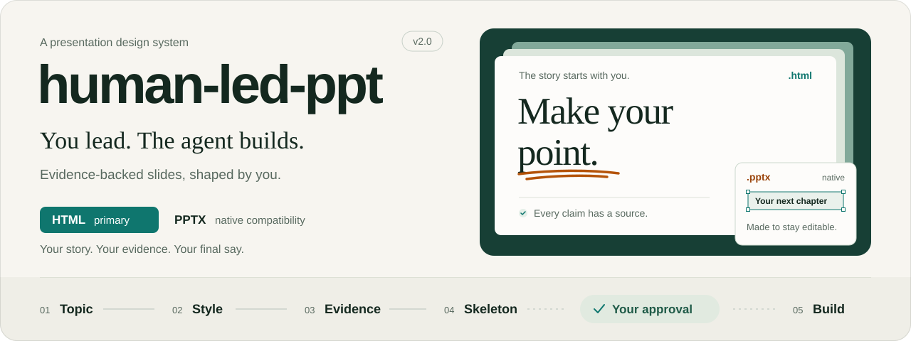
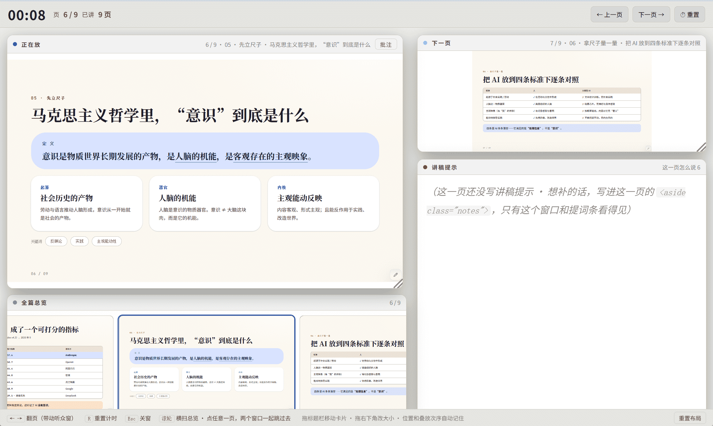
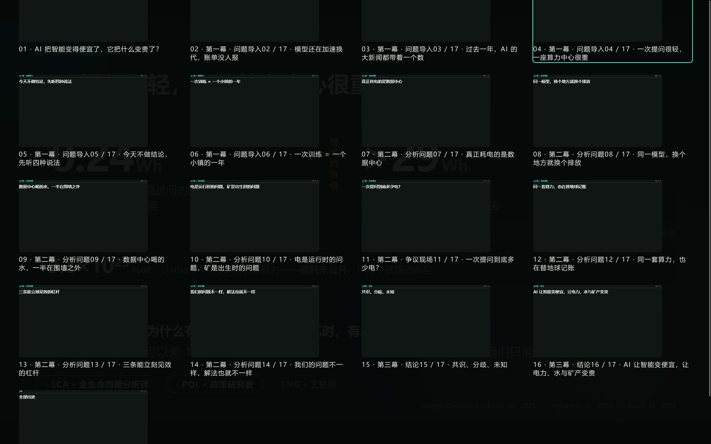
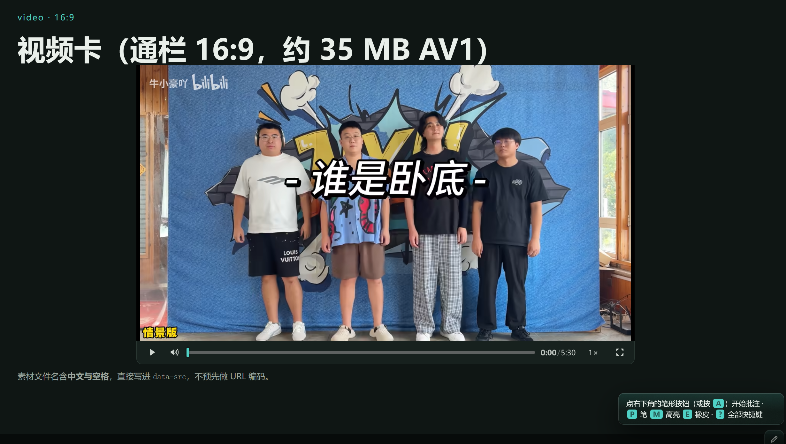

<h1 align="center"></h1>

[English](README.md) · **中文** · [日本語](README_ja.md)

**以人主导、Agent 辅助的 PPT 设计系统。HTML 是主轨，原生 PPTX 是兼容交付。** 人定主题、风格与措辞，Agent 管证据、结构与构建纪律；五步各留一份可审核的文件，用户点头之后才允许构建。

   

> [!note]
> 本项目已经迁移到 Codeberg 开发。GitHub 只作为副本同步。

## 为什么以 HTML 为主轨

- **轻量。** 一个 `.html` 文件通常几百 KB，双击离线打开，零依赖、零安装；发给谁都能看。
- **更适合 Agent 编写。** 纯文本、可 diff、可 grep、可逐段改，改一版只要几秒；PPTX 是二进制包，每次改动都要经 CLI/脚本，出问题定位更绕。
- **审美上限更高。** CSS/SVG 能做到 PPT 原生对象难做的精确排版、透明叠加、非标准网格、自定义图表与克制动效；同一套设计语言，HTML 版的观感通常更好。
- **交互完整。** 键盘/点击/触屏翻页、`G` 缩略图总览、`F` 全屏、URL 记忆页码、竖屏遮罩；可选屏幕批注（钢笔/荧光笔/黑板）与演讲者双窗。
- **改稿与评审成本最低。** 直接改 HTML/CSS，截图就能评审；不用在 PowerPoint 里逐个拖形状。

所以：**除非你有 `.pptx` 的硬性交付要求，否则默认选 HTML。** 要交作业、进单位模板、别人要接着改，才走 PPTX 兼容轨道。

## 两种交付形态

| 形态 | 适合 | 产物 | 代价 |
|---|---|---|---|
| **HTML 演示（主轨）** | 现场讲、课堂、评审、需要批注/双窗/总览 | `<主题>.html` 单文件 | 不是 `.pptx`，不能在 PowerPoint 里逐形状编辑 |
| **原生 PPTX（兼容）** | 要交文件、进企业模板、别人要续改 | `<主题>.pptx` + `-PPTX-src.json` + `-PPTX-qa.md` | 没有总览/批注/双窗/深链；受目标机器字体影响；需 officecli |
| **两份都要** | 既要现场讲又要交文件 | 上面两套 | 每页维护两套落位，构建与验收约翻倍 |

第 1 步会把固定的对比文案原样贴给用户，**不替用户默认**。两种形态共用同一套主题、资料总结、叙事弧度与骨架；只有第 5–6 步分叉。

## 五步 + 两个可选层（HTML 主轨）

| 步 | 做什么 | 产出 |
|---|---|---|
| 1 主题与叙事 | **先选交付形态**；定主问题、受众、时长页数、分幕结构与张力弧度 | 需求确认块 |
| 2 风格方向 | 9 套气质预设（Fluent / Material 3 / 纸面中性 / 人文出版物 / Liquid Glass / 文档清单 / 漫画风 / 学术 / 趣味）与 13 套模板（J–Q 版式 + R–V 五套完整风格） | 风格决定块 |
| 3 资料库（按需） | 循证检索：明确标出争议、二手转引、打不开 | `主题-资料总结.md` |
| 4 骨架说明书 | 分幕、**每页关键字**（内核三项 `type`/`key`/`sec`，其余从 56 词词库选 5–11 个）、实现细则、演讲者提示词 | `主题-HTML-PPT骨架.md` 或 `主题-PPTX骨架.md`（**等用户审核**） |
| 5 构建 | HTML：严格按骨架出单文件；PPTX：按骨架写 `PPTX-src.json`，再用版式编译器出原生对象 | `主题.html` / `主题.pptx` |
| 6 自检与交付 | HTML：静态自检 + 浏览器实测 + 数字审计；PPTX：规格/成品双检 + validate + issues + 逐页截图 | 实测通过项 + 未验证项 |
| 7 屏幕批注（可选，HTML） | 钢笔、荧光笔、两种橡皮、按页存笔迹 | 同一份 `主题.html` 多一个叠加层 |
| 8 演讲者模式（可选，HTML） | 第二个窗口：计时横幅 + 当前页/下一页/提示词/总览四张磁吸卡，双窗双向翻页 | 同一份 `主题.html` 再多一个叠加层 |

第 3 步只在需要外部数据或用户点名要检索时运行。第 4 步是唯一一道绝不跳过的闸门。第 7/8 步只服务 HTML；PPTX 用 PowerPoint 自带的墨迹与演讲者视图，骨架 §7 的提示词仍写进原生备注。

## PPTX 兼容轨道

### 什么时候走

用户明确要 `.pptx`、要交作业/评审、要把文件交给别人继续改，或单位流程只收 PowerPoint。**不要**因为“PPT 这个词”就默认走 PPTX——先让用户选。

### 引擎规则（强制）

| 宿主 | 用什么 |
|---|---|
| Claude Code / Codex / ZCode | 优先用该宿主已装的 **PPTX 能力插件**；没有就**回退 officecli**，并明确告知 |
| DeepSeek Harness（dsh） | 先检查已装 PPTX 插件；没有则用 officecli |
| 其他（Qoder、Cursor、VS Code、仓库副本等） | **officecli 强制**；缺则只安装二进制 |

- 安装：Windows `irm https://d.ai.officecli.ai/install.ps1 | iex`；macOS/Linux `curl -fsSL https://d.ai.officecli.ai/install.sh | bash`；或 `npm i -g @officecli/officecli` / `scoop install officecli` / `brew install officecli`。
- **不要执行 `officecli install`**：它会顺手把 officecli 自己的 skills/MCP 装进所有检测到的 agent。只装二进制，验证 `officecli --version >= 1.0.159`。
- 宿主插件路线的产物不跑本 skill 的 `lint`，验收下限更低；交付说明要写清。

### 产物

```text
<主题>-PPTX-src.json    # 依骨架写的页规格；可审、可 diff
<主题>.pptx             # 原生形状/文字/表格/图表/图片/媒体/备注
<主题>.pptx.batch.json  # 实际执行的 officecli 命令，出问题先看它
<主题>-PPTX-qa.md       # 验收报告
```

### 构建与验收

```bash
node <skill目录>/assets/pptx/detect-engine.cjs --json
node <skill目录>/assets/pptx/build.cjs <主题>-PPTX-src.json <主题>.pptx
node <skill目录>/assets/pptx/lint.cjs <主题>-PPTX-src.json <主题>.pptx \
  --skeleton <主题>-PPTX骨架.md --sources <主题>-资料总结.md --report <主题>-PPTX-qa.md
officecli validate <主题>.pptx
officecli view <主题>.pptx issues --json
officecli view <主题>.pptx screenshot --page 1 --out shots/s1.png
```

- 12 个版式 recipe 覆盖封面、幕间、主张、要点、KPI、表格、图表、对比、图示、图片、代码、收束；每页一个主语、四档字号、accent ≤1、warn ≤1、卡片 ≤4。
- 文字容量是硬闸门：放不下直接报错，**不缩字**。
- 切页统一 `fade` 400ms；**没有页内动画**。读不回 400ms 就删光切换，并在交付说明里让你自行添加。
- 图片/音视频会嵌入 `.pptx`；单张图片建议 ≤2MB。
- 本机没有 PowerPoint 时，截图走 officecli 的 HTML 渲染路径：它证明版式结构，不证明 PowerPoint 像素级一致；交付时会请你打开一次。

## 安装与使用

把 `human-led-ppt/` 放进你的 skill 目录，重载会话，然后 `/human-led-ppt`，或直接说：

- “帮我做个关于 X 的 HTML 演示” → HTML 主轨
- “帮我做个要交的 PPT / 可编辑的 pptx” → PPTX 兼容轨道
- “两份都要” → 先各写一份骨架，再分别构建

五步文档各有 [English](references/en)、[中文](references/zh)、[日本語](references/ja) 三套镜像；PPTX 轨道的 `05b-pptx.md` / `06b-pptx.md` 同样三语。

## 成品能力对照

| 能力 | HTML 主轨 | PPTX 兼容轨 |
|---|---|---|
| 体积 | 单文件几百 KB | 图片/媒体会撑大，几十 MB 常见 |
| Agent 迭代 | 纯文本，改完即看 | 改 JSON 后重编译，多一步 |
| 版式精度 | CSS/SVG 像素级 | 原生对象，受字体与 PowerPoint 排版影响 |
| 审美上限 | 更高：透明叠加、非标准网格、自定义图表 | 受 PowerPoint 对象模型约束 |
| 翻页/总览/全屏 | 内置 `G`/`F`/键盘/触屏 | PowerPoint 自带 |
| 屏幕批注 / 黑板 | 第 7 步叠加层 | 无；用 PowerPoint 墨迹 |
| 演讲者双窗 | 第 8 步叠加层 | 无；用 PowerPoint 演讲者视图 |
| 深链 / 竖屏遮罩 | 有 | 无 |
| 媒体播放条 | 壳内置 | PowerPoint 原生 |
| 备注 | `.notes` + 演讲者窗强调 | 原生备注，纯文本 |
| 可编辑性 | 需改源码 | 原生形状/表格/图表可直接改 |
| 证据链 | 交互式徽标（按稿开启） | 静态来源页脚 + 来源页 |

## 功能示例








## 已知限制

- HTML 风格预设是对品牌观感的合理近似，不是官方设计令牌；改色后必须重测对比度。
- 文档里提到的第三方 skill 名称是 2026-10-14 的市场快照，未安装也未验证正文；调用前请复核并让用户确认。
- 文档里的示例全是占位符（`<…>` / `……`），不要照抄数字，也不许让占位符进成品。
- PPTX 轨道的模板/母版路线尚未纳入第一版；不要承诺“套用单位模板”。
- PPTX 不支持页内动画、Morph、自动旁白，也不支持编辑任意旧 `.pptx`；只从骨架新建。
- PPTX 的对数轴、瀑布、双单位图表会降级为表格或简单条形图。
- 没有 PowerPoint 时无法做像素级验收；截图只证明版式结构。

## 2.0 更新

- **原生 PPTX 兼容轨道**：`officecli` + JSON 页规格 + 版式编译器，产出可编辑的原生形状/表格/图表/图片/媒体/备注；切页统一 fade 0.4s，不加页内动画；构建前后双检 + 逐页截图复核。
- **banner 重绘**：左侧放大品牌与人主导理念，右侧叠放 HTML 幻灯片与可编辑的原生 PPTX 卡片，底部串联五步流程与人工审核闸门。
- **HTML 仍是主轨**：README 与第 1 步都先讲 HTML 的优势；只有硬性要 `.pptx` 时才走兼容轨道。
- **README 三语重写**：结构改为“为什么 HTML 为主 → 两种形态 → 五步 → PPTX 兼容轨道 → 安装 → 对照表 → 限制”。

完整记录见 [CHANGELOG_zh-cn.md](CHANGELOG_zh-cn.md)。

## 致谢与出处

1. **版式模板与演讲者模式**：参考 [`lewislulu/html-ppt-skill`](https://github.com/lewislulu/html-ppt-skill)（"HTML PPT Studio"）——一套模板 = 一份 `:root` token + 一组现成页型，配 `--accent-ink` 与图片容器规范；双窗预览、磁吸卡、提示词卡与计时器的交互形态来自它的演讲者模式。**参考方法论与交互设计，代码没有复制**：所有实现按本 skill 的约束重写过——单文件、零外部依赖、叠加层只能追加在 `</body>` 之前并由 `assemble.cjs` 装配、提示词正文归骨架 §7 管；窗口同步改用 `postMessage`（含 `opener → parent` 回落）。
2. **PPTX 轨道的方法论**：参考 [`hugohe3/ppt-master`](https://github.com/hugohe3/ppt-master)（MIT）——锁定设计规格、逐页蓝图、编译原生对象、渲染复核、默认只给 0.4s fade 切页；**没有复制它的代码，也没有引入它的 SVG 管线**。
3. **PPTX 工具**：[OfficeCLI](https://github.com/iOfficeAI/OfficeCLI)（Apache-2.0）——单二进制、无需安装 Office 即可读写 `.pptx`。

## 许可

MIT（见 [`LICENSE`](LICENSE)）。版权所有者：Makitoid Wang。
